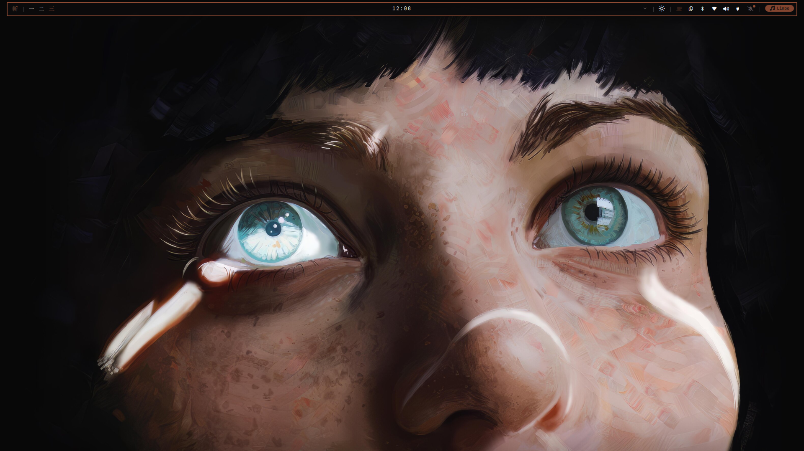
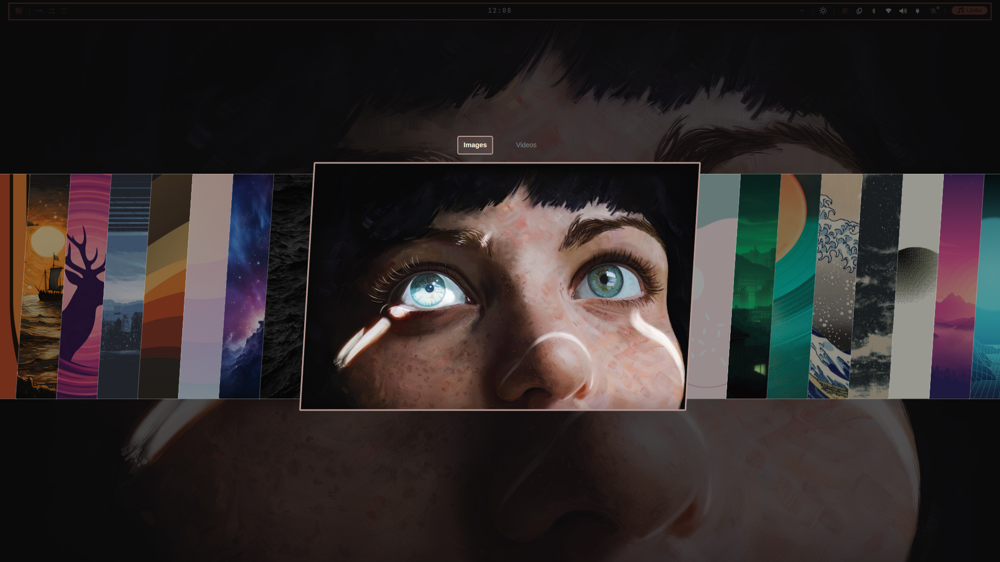
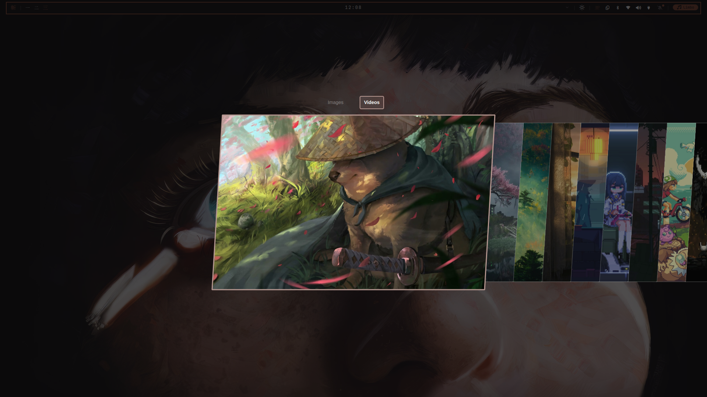
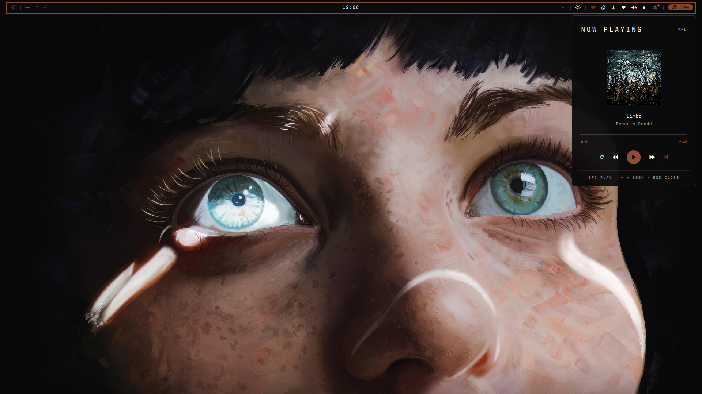
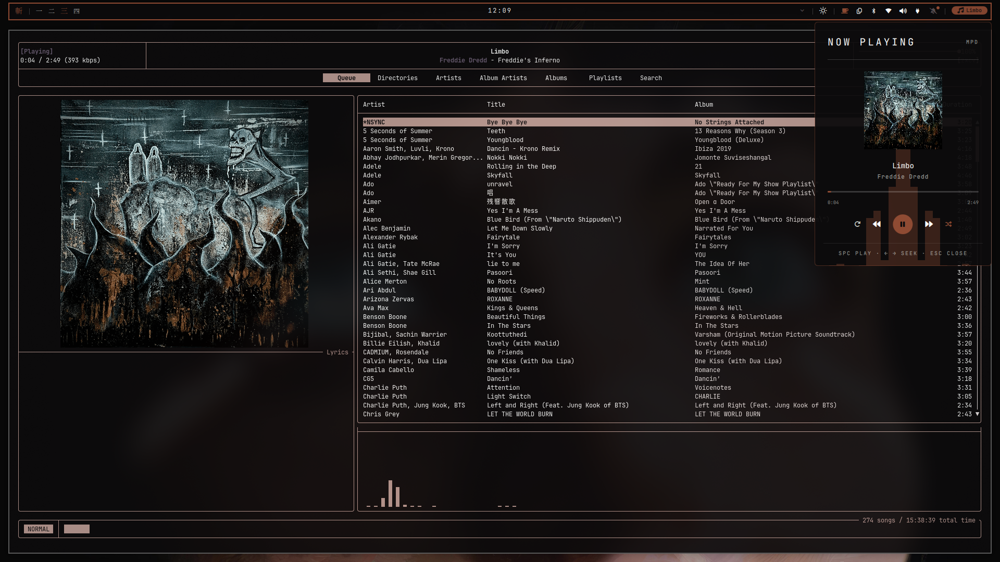
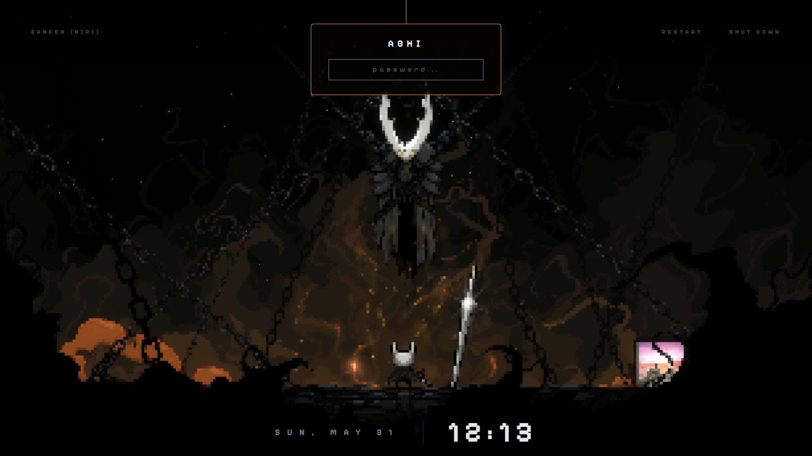
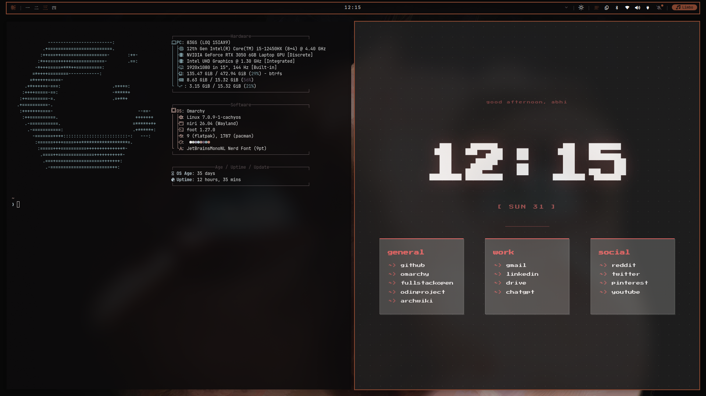

# Zanken

A Niri-based Linux workspace.

## Screenshots

| | |
|---|---|
|  |  |
| Desktop with Quickshell bar | Wallpaper picker |
|  |  |
| Wallpaper selection | Now Playing popup |
|  |  |
| rmpc music player | Lock screen (qylock) |
|  | |
| Quickshell dashboard | |

Built around the [Niri](https://github.com/YaLTeR/niri) scrolling compositor and [Quickshell](https://quickshell.outfoxxed.me/), with 300+ scripts for desktop and hardware tasks.

## Install

> **Status: alpha.** There is no stable release yet, so every install uses the `dev`
> channel (`ZANKEN_RELEASE_MODE=dev`). Without it the installer stops with
> "No Zanken stable release available".

**Requirements:** x86_64 Arch Linux or an Arch-based distribution (CachyOS works), a
regular user with `sudo`, and an internet connection. Run the installer from a TTY
(log out of any graphical session first), as your regular user, never as root.

### Desktop install on an existing Arch system (recommended)

This replaces your Niri/Quickshell desktop configuration with Zanken's. It does not
touch disks, partitions or the bootloader, and it backs up the configs it replaces.

```bash
sudo pacman -Syu --needed git python jq
ZANKEN_RELEASE_MODE=dev bash <(curl -fsSL https://raw.githubusercontent.com/selfAnnihilator/zanken/main/boot.sh) --desktop
```

Type `REPLACE` when asked, then confirm the installer prompt. When it finishes, reboot.
You get the Pixel Sakura login screen; choose **Zanken (Niri)** from the session menu.

### Full install on a fresh Arch system

For a clean x86_64 Arch install with a Btrfs root and Limine. This path provisions
the whole system, including bootloader and snapshot configuration, so use it only on
a machine you are happy to reconfigure.

```bash
ZANKEN_RELEASE_MODE=dev bash <(curl -fsSL https://raw.githubusercontent.com/selfAnnihilator/zanken/main/boot.sh)
```

### Add the login screen to an existing Zanken install

```bash
~/zanken/bin/zanken-setup-login
```

Installs SDDM with the Pixel Sakura theme and enables it for the next boot. The boot
animation is installed too, but it is not working yet on every setup.

### Updating

```bash
zanken update --fetch
```

See [Installation](docs/installation.md) and [Replace an existing Niri desktop](docs/desktop-takeover.md)
for details, rollback and recovery.

## What's included

- **[Niri](https://github.com/YaLTeR/niri)** — scrolling tiling Wayland compositor
- **[Quickshell](https://quickshell.outfoxxed.me/)** — QML bar with audio, wifi, bluetooth, music, weather popups
- **308 scripts** — `zanken-*` commands for everything from themes to hardware detection
- **21 built-in themes** — tokyo-night, catppuccin, kanagawa, gruvbox, nord, and more
- **Dynamic wallpaper colors** — palette extracted from wallpaper via zanken-wallpaper-colors

## Documentation

**[selfAnnihilator.github.io/zanken](https://selfAnnihilator.github.io/zanken)**

Build or preview the documentation locally with `mkdocs build --strict --clean`
or `mkdocs serve`. See [Documentation Development](docs/development.md) for
the required Arch packages and command-reference workflow.

- [Installation](https://selfAnnihilator.github.io/zanken/installation)
- [Keybinds](https://selfAnnihilator.github.io/zanken/keybinds)
- [Themes](https://selfAnnihilator.github.io/zanken/themes)
- [Commands](https://selfAnnihilator.github.io/zanken/commands)
- [Configuration](https://selfAnnihilator.github.io/zanken/configuration)

## Quick reference

```bash
zanken-theme-set tokyo-night    # switch theme
zanken-theme-bg-set wall.jpg    # set wallpaper + extract palette
zanken-audio-input-mute         # toggle microphone
zanken-capture-screenshot       # take screenshot
zanken-default-terminal kitty   # change default terminal
```

## Structure

```
zanken/
├── bin/          # 308 zanken-* scripts (on $PATH)
├── config/       # Base configs
├── default/      # Default app and managed desktop configs
├── themes/       # 21 built-in color themes
├── install/      # Install phase scripts
└── migrations/   # Version migration scripts
```

## Credits

Quickshell bar and popups derived from [bjarneo/quickshell](https://github.com/bjarneo/quickshell).

Lock screen and SDDM theme derived from [Darkkal44/qylock](https://github.com/Darkkal44/qylock).

## License

[MIT](LICENSE)
